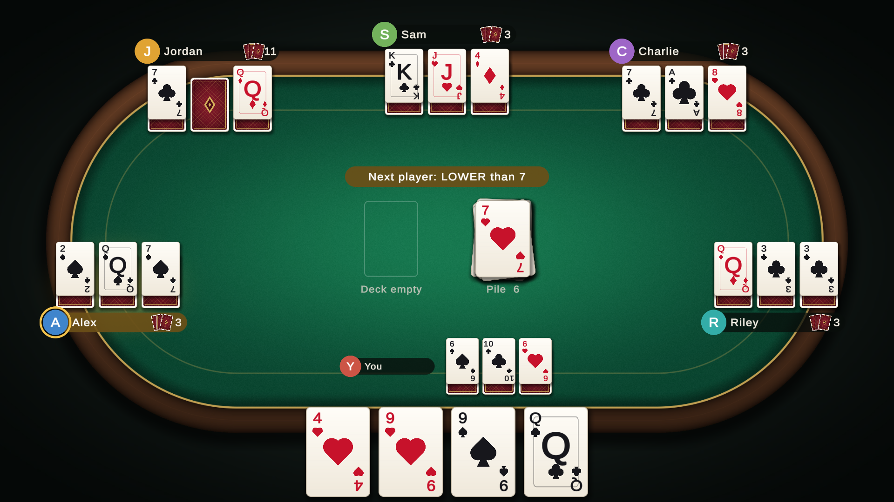

# Stage 1 – Project Foundation: Setup Guide

What you get at the end of this stage: a landscape Unity project with the poker table,
original card art, Card and Seat prefabs, and a preview scene showing the table for 2–10 players.
**There are no game rules yet.** Those start in Stage 2.



---

## 1. Create the Unity project

1. Open **Unity Hub → New project**.
2. Editor version: **6000.4.3f1** (your install already has Android and iOS build support).
   *Alternative:* 6000.6.10f1. It is newer but has no Android/iOS modules yet. To add them:
   Hub → Installs → ⚙ → Add modules → Android Build Support + iOS Build Support.
3. Template: **Universal 2D**.
4. Project name: `Palace`. Pick a location such as `Documents\GitHub\Palace`.
5. Click **Create project** and wait for the Editor to open.

> iOS note: Unity on Windows can *prepare* an iOS build, but installing it on an iPhone needs
> a Mac with Xcode. Android and Windows builds work directly from your PC.

## 2. Add the Stage 1 files

Copy the **`Assets/Palace`** folder from this delivery into your project's **`Assets`** folder.
Copy the whole folder, not the files one by one. Unity compiles the scripts automatically.
Wait for the spinner in the bottom-right corner to stop, and check that the Console shows no red errors.

```
Assets/
└── Palace/
    ├── Editor/                     (editor-only tools, never included in builds)
    │   ├── PalaceProjectSetup.cs   Menu: project settings + runs everything
    │   ├── PalaceArtGenerator.cs   Menu: draws all card/table art as PNGs
    │   └── PalaceSceneBuilder.cs   Menu: builds prefabs + Game scene
    └── Scripts/
        ├── Core/
        │   └── Card.cs             Rank, Suit, Card (pure data, no Unity visuals)
        ├── Visuals/
        │   ├── CardTheme.cs        ScriptableObject: card look
        │   ├── TableTheme.cs       ScriptableObject: table/seat look
        │   ├── CardView.cs         displays one card, handles taps
        │   ├── CardFactory.cs      spawns CardViews
        │   └── UIBuild.cs          helpers for building UI from code
        ├── Table/
        │   ├── TableLayout.cs      seat-position maths (2–10 players)
        │   ├── TableView.cs        table, centre piles, seats, hand area
        │   └── SeatView.cs         one player's seat
        ├── UI/
        │   ├── SafeAreaFitter.cs   keeps HUD clear of phone notches
        │   └── AppBootstrap.cs     60 FPS, keep screen awake
        └── Debug/
            └── TableLayoutPreview.cs  Stage 1 test harness (temporary)
```

## 3. Run the setup tools

In the Unity menu bar: **Palace → Setup → Run Full Stage 1 Setup**.

This runs three steps in order (you can also run each one on its own from the same menu):

| Step | What it does |
|---|---|
| **1 – Apply Project Settings** | Landscape-only on phones (both landscape directions allowed). 1920×1080 resizable window on PC. Imports the TextMeshPro default font if it is missing. |
| **2 – Generate Art** | Draws the card face, card back, suits, felt table, background and UI shapes as PNGs in `Assets/Palace/Art/Generated`. Creates `Settings/CardTheme.asset` and `Settings/TableTheme.asset`. |
| **3 – Build Prefabs and Game Scene** | Creates `Prefabs/Card.prefab`, `Prefabs/Seat.prefab` and `Scenes/Game.unity` with every reference already connected, then adds the scene to Build Settings. |

If Unity asks whether to save the current scene, choose **Save** or **Don't Save** (the Universal 2D template's sample scene isn't needed).

## 4. Preview it

1. Open `Assets/Palace/Scenes/Game.unity`. Step 3 leaves it open.
2. In the **Game** tab, set the resolution dropdown to **Full HD (1920x1080)**.
3. Press **Play**.

### What to check

- [ ] The green felt table fills the screen, with a leather rail and gold trim.
- [ ] Use the **− / +** buttons (top-left) to change between 2 and 10 players.
      The seats rearrange and never overlap.
- [ ] The gold glow and ring move from player to player every 1.5 seconds (turn indicator).
- [ ] Tap or click your hand cards along the bottom: they lift up with a gold glow, and tapping again lowers them.
      You can select both 9s at once, which is how multiple-card selection will look.
- [ ] Opponents show three face-down cards with three face-up cards on top, and a small
      card-back fan with their hand count (Jordan shows 11 to simulate a big pick-up).
- [ ] Phone shapes: **Window → General → Device Simulator**, then choose a phone such as an iPhone or a Pixel,
      rotated to landscape. The whole table stays visible.

Expected renders for comparison are in [`previews/`](previews/) (2, 4, 6 and 10 players, plus phone and tablet aspect ratios).

---

## What the builder created (and how it is wired)

You don't need to connect anything by hand. Here is what the builder connected for you, so you know where to look.

### Game scene hierarchy
```
Main Camera            Orthographic, dark background
GameCanvas             Canvas: Screen Space – Camera (uses Main Camera)
│                      Canvas Scaler: Scale With Screen Size, 1920x1080, Screen Match Mode = Expand
├── Background         Image (TableTheme.background), stretched to fill the screen
├── Table              TableView
│   ├── TableFelt      Image (TableTheme.table), 1800x900
│   ├── Centre         Deck slot/stack, discard slot/pile, labels, effect banner
│   ├── Seats          Seat prefabs are spawned here at runtime
│   └── LocalHand      Your hand cards are spawned here
└── HUD (Safe Area)    SafeAreaFitter. Buttons and menus go in here
EventSystem            Input System UI Input Module
Game                   AppBootstrap + TableLayoutPreview
```

### Inspector references
| Object → Component | Field | Points to |
|---|---|---|
| Table → TableView | Table Theme / Card Theme | `Settings/TableTheme`, `Settings/CardTheme` |
| | Seat Prefab / Card Prefab | `Prefabs/Seat`, `Prefabs/Card` |
| Game → TableLayoutPreview | Table | the **Table** object |
| | Controls Parent | the **HUD (Safe Area)** object |
| Card prefab → CardView | Theme | `Settings/CardTheme` |
| Seat prefab → SeatView | Table Theme / Card Theme / Card Prefab | the two themes and `Prefabs/Card` |

Fields under **"Built automatically – do not assign"** are filled in by the scripts themselves.

### Things you can safely tweak
- **TableView → Seat layout**: `Seat Path Size` (the racetrack the seats sit on), `Local Gap`
  (space kept for you at the bottom) and `Min Seat Scale`. Changes take effect the next time seats are built.
  In Play mode, press − then + to rebuild.
- **CardTheme / TableTheme**: colours, plus a custom font if you want one.
- **TableLayoutPreview**: player count, turn cycling speed, random seed.

---

## Visual style guide

| Element | Colour | Notes |
|---|---|---|
| Room background | `#1D2924` → `#050807` | dark radial vignette |
| Felt | `#17784F` → `#0A4530` | radial gradient, subtle noise, printed racetrack line |
| Rail | `#5A3620` / `#1E110A` | padded leather, lit from above |
| Trim / accents | `#D4AF5A` gold | brass trim, turn glow, selected cards |
| Card face | `#FFFDF8` ivory | rounded corners, large corner index for small phone screens |
| Red suits | `#C7122B` | |
| Black suits | `#17171C` | |
| Card back | `#7E1828` burgundy + gold lattice | |
| Name plates | black at 78% opacity | turn = dark gold plate + gold ring around the avatar |

Design rules: the table is the hero; the UI stays dark and minimal around it. Seats stay upright so names are always readable.
Number cards use one large centre suit instead of pips, so they read instantly at seat size. Court cards show a large letter inside a thin frame.

All art is drawn from code by `PalaceArtGenerator`, so it is 100% original with no licence concerns.
To restyle the cards later, edit the colours at the top of that file and re-run **Generate Art**.

---

## Troubleshooting

| Problem | Fix |
|---|---|
| Text is missing on cards or name plates | Window → TextMeshPro → Import TMP Essential Resources, then run **Palace → Setup → 3 – Build Prefabs and Game Scene** again. |
| Red errors about `InputSystemUIInputModule` or input | Edit → Project Settings → Player → Active Input Handling → **Input System Package (New)** or **Both**, then rebuild the scene (step 3). |
| Table looks small, or the sides are cut off | Make sure the Game view isn't set to "Free Aspect" with a tiny window. Use Full HD 1920×1080 or the Device Simulator. |
| Anything else | Copy the first red error from the Console and send it to me. |
